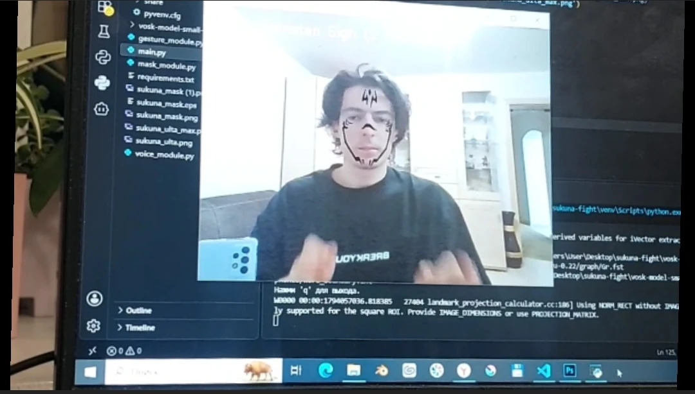
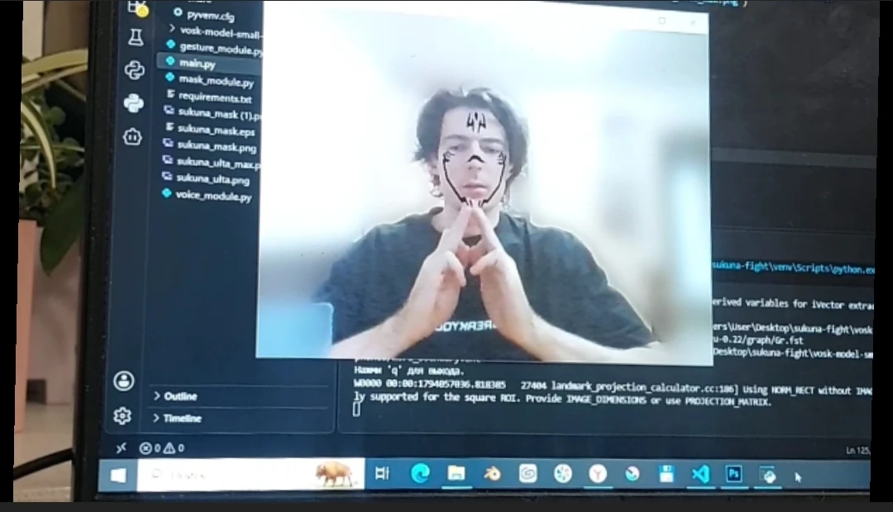
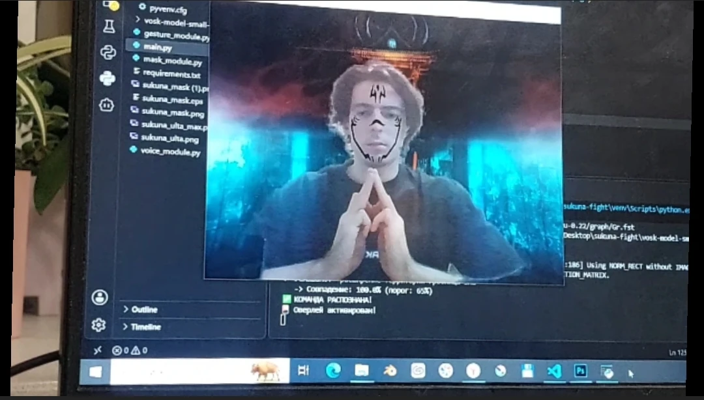

# Sukuna Domain Expansion AR

[](https://www.python.org/)
[](https://opencv.org/)
[](https://mediapipe.dev/)
[](https://alphacephei.com/vosk/)
[](LICENSE)

An interactive Augmented Reality (AR) simulator and game based on Ryomen Sukuna from the anime "Jujutsu Kaisen". This project applies signature face tattoos in real-time, recognizes the Buddhist Enmaten hand seal (mudra), and uses local voice recognition to trigger the Domain Expansion effect with background blurring and environment overlays.

---

## Example Result

Here are the three stages of the AR experience:

| 1. Basic Mask | 2. Hand Seal & Blur | 3. Domain Expansion |
|:---:|:---:|:---:|
|  |  |  |
| *Face tattoo applied* | *Enmaten sign activated, background blurred* | *Full effect with Malevolent Shrine overlay* |

---

## Note on origin

The project was **originally written on 06.11.2026 in VS Code** as a single monolithic script (`main.py`). It has since been refactored into a modular Python 3.12 project to separate computer vision tasks (face mesh, hand tracking, audio processing, and logic).

---

## About the Project

| Feature | Where in code | Manual / Library |
|---|---|---|
| Face Mask AR | `mask_module.py` → `SukunaMask.process()` | Library (`mediapipe`) |
| Hand Gesture (Enmaten) | `gesture_module.py` → `check_sign()` | Library (`mediapipe`) + **Manual** math |
| Background Blur | `gesture_module.py` → `process()` | Library (`mediapipe`) + OpenCV |
| Voice Command ("Расширение территории") | `voice_module.py` → `_listen()` | Library (`vosk`, `rapidfuzz`) |
| Foreground/Background Overlay | `main.py` → `overlay_foreground()` | **Manual** OpenCV logic |

---

## 💡 Key Technical Challenges & Solutions
*(For Recruiters/Employers: Here are the most challenging bugs I encountered and solved during development, demonstrating my problem-solving and math skills).*

### 1. Fixing 3D Mask Distortion (Perspective vs. Affine)
*   **Problem:** The standard approach of using 4 points and `cv2.getPerspectiveTransform` squashed the 2D image when mapping it onto a 3D human face. The mask looked like a flat "line" on the nose.
*   **Solution:** Switched to `cv2.getAffineTransform` using a "golden triangle" of 3 landmarks (forehead left, forehead right, chin). This preserves the 2D aspect ratio of the image, treating it like a flexible sticker rather than a heavily warped polygon.

### 2. Stabilizing the Hand Gesture (3D Vector Math)
*   **Problem:** The gesture was triggering randomly when hands were facing the camera directly. Due to the "Enmaten" mudra, the index and middle fingers are usually hidden from the webcam.
*   **Solution:** 
    *   Focused logic solely on the visible fingers (ring up, pinky down).
    *   Implemented a 3D cross-product calculation (`np.cross`) using `multi_hand_world_landmarks` to find the **palm normal vector**. The system now verifies the Z-axis of the hand, ensuring the palms are facing *sideways* to the camera before registering the gesture.

### 3. Synchronizing Voice Commands with Game State
*   **Problem:** The voice command could trigger the "Malevolent Shrine" overlay even when the Domain Expansion (background blur) wasn't active.
*   **Solution:** Created a state-machine logic in `main.py` (`voice_triggered_during_blur`). The voice module now only acts as a flag; the main loop checks if `time.time() < blur_end_time` before rendering the overlay, ensuring the visual effects strictly follow the in-game timer.

### 4. The "White Halo" Rendering Bug
*   **Problem:** A white border appeared around the black tattoo mask due to anti-aliasing in the original PNG (semi-transparent white pixels).
*   **Solution:** Solved during asset creation by vectorizing the image and using Photoshop's "Remove White Matte" to force semi-transparent pixels to blend with the darkness of the mask, eliminating the halo.

### 5. Library API Deprecation
*   **Problem:** The fresh MediaPipe installation threw an `AttributeError: module 'mediapipe' has no attribute 'solutions'`.
*   **Solution:** Analyzed the release notes, downgraded the package to `0.10.21` in `requirements.txt` to maintain compatibility with the legacy `FaceMesh` and `Hands` APIs.

---

## Dataset / Data

| Property | Value |
|---|---|
| Source | Local folder `doc/` |
| Format | `.png` (RGBA for masks), `.webp` (screenshots) |
| Structure | `sukuna_mask.png` (tattoo), `sukuna_ulta.png` (background), `sukuna_ulta_max.png` (foreground filter) |
| Preprocessing | Removed white halos via Photoshop ("Remove White Matte"), vectorized for crisp edges |

---

## Installation and Run

### 1. Clone the repo

```bash
git clone https://github.com/artrokza-lang/sukuna-domain-expansion.git
cd sukuna-domain-expansion
```

### 2. Create a virtual environment

```powershell
python -m venv venv
venv\Scripts\activate
```

### 3. Install dependencies

```bash
pip install -r requirements.txt
```
*(If `pyaudio` fails on Windows: `pip install pipwin` -> `pipwin install pyaudio`)*

### 4. Download the Vosk Model
Download the Russian language model **[vosk-model-small-ru-0.22](https://alphacephei.com/vosk/models)** (approx. 45 MB). 
Extract the archive so that the folder `vosk-model-small-ru-0.22` is located in the project root (next to `main.py`). Inside, you should see the `am`, `conf`, `graph`, and `ivector` folders.

### 5. Run

```bash
python main.py
```

---

## Hyperparameters

| Parameter | Value | Where |
|---|---|---|
| `mask_end_pct` | `0.90` | `mask_module.py` → `SukunaMask.__init__` |
| `scale_x` | `0.3` | `mask_module.py` → `SukunaMask.__init__` |
| `offset_y` | `-15` | `mask_module.py` → `SukunaMask.__init__` |
| `BLUR_DURATION` | `10` | `gesture_module.py` → `SukunaGesture.__init__` |
| `threshold` (Palm angle) | `0.8` | `gesture_module.py` → `check_sign` |
| `threshold` (Voice) | `65` | `voice_module.py` → `VoiceCommandListener.__init__` |

---

## Results Analysis

| Aspect | Status | Notes |
|---|---|---|
| Face tracking | ✅ | Works excellently in good lighting conditions. |
| Gesture detection | ✅ | Uses palm normal (rotation) check to filter out false positives. |
| Voice recognition | ✅ | Vosk runs locally; `rapidfuzz` forgives slight pronunciation errors. |
| Background segmentation | ⚠️ | MediaPipe may occasionally lose clothing edges on complex backgrounds. |

---

## Troubleshooting / Environment Issues

### 1. `ERROR (VoskAPI:Model()): Folder '...' does not contain model files`
**Cause:** The Vosk model archive was not unzipped, or the path is incorrect.
**Fix:** Extract the model and specify the absolute path in `main.py`:
```python
model_path=r"C:\Users\User\Desktop\sukuna-fight\vosk-model-small-ru-0.22"
```

### 2. `ModuleNotFoundError: No module named 'gesture_module'`
**Cause:** The file was saved with a double extension (e.g., `.py.txt`) or is in a different folder.
**Fix:** Enable file extensions in Windows Explorer and rename the file, removing the `.txt`.

---

## Roadmap

### Phase 1 — AR Mask (Done)
- [x] Face tracking (Face Mesh).
- [x] Calibration and mask overlay.

### Phase 2 — Gestures and Blur (Done)
- [x] Hand gesture recognition (Enmaten).
- [x] Palm rotation angle verification.
- [x] Background blur (Selfie Segmentation) with a 10-second timer.

### Phase 3 — Voice Control (Done)
- [x] Local Vosk integration.
- [x] Fuzzy search for the "расширение территории" command.
- [x] Background and foreground overlay application.

### Phase 4 — Gameplay (In Progress)
- [ ] Add Mahoraga (enemy).
- [ ] Mahoraga adaptation mechanic.
- [ ] Voice and gesture attacks (Dismantle, Cleave, Fuga).

---

## Project Structure

```text
sukuna-domain-expansion/
├── .gitignore
├── README.md
├── requirements.txt
├── main.py                # Main loop, module integration
├── mask_module.py         # Face mask overlay
├── gesture_module.py      # Gestures, timer, blur
├── voice_module.py        # Vosk and audio stream
├── doc/                   # Image assets folder
│   ├── sukuna_mask.png
│   ├── sukuna_ulta.png
│   ├── sukuna_ulta_max.png
│   ├── 1.webp
│   ├── 2.webp
│   └── 3.webp
└── vosk-model-small-ru-0.22/ # (Not uploaded to GitHub, downloaded manually)
```

---

## Limitations

- **Lighting** — MediaPipe requires good lighting to recognize fingers (especially when palms are turned sideways).
- **Microphone** — Vosk is sensitive to background noise; it is best used in a quiet room.
- **Performance** — Running Face Mesh, Hand Tracking, and Selfie Segmentation simultaneously can be CPU-intensive. FPS drops may occur on weaker laptops.

---

## License

MIT — free to use, modify and distribute.
